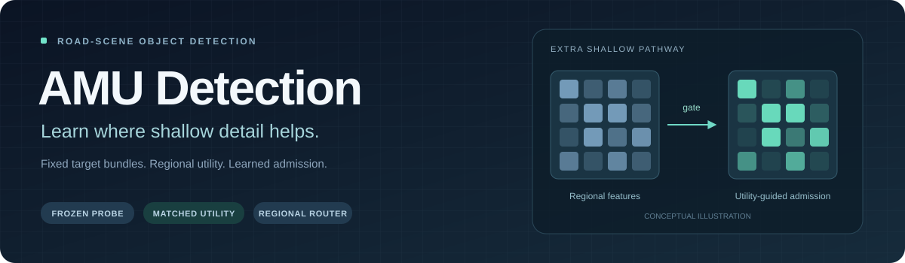
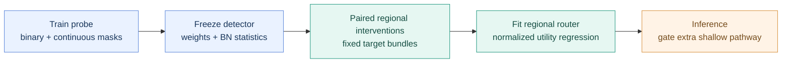

<p align="center">
  
</p>

<p align="center"><strong>Assignment-Matched Utility Supervision for Road-Scene Object Detection</strong></p>

<p align="center">
  <a href="https://github.com/Nopon-Knowledge/AMU-Detection/actions/workflows/ci.yml"></a>
  <a href="pyproject.toml"></a>
  <a href="https://pytorch.org/"></a>
  <a href="LICENSE"></a>
</p>

<p align="center">
  <b>English</b> · <a href="README.zh-CN.md">简体中文</a><br>
  <a href="#the-idea">The idea</a> · <a href="#quick-start">Quick start</a> · <a href="#training-pipeline">Training</a> · <a href="#reproducibility">Reproducibility</a> · <a href="#documentation">Documentation</a>
</p>

Shallow features carry object boundaries and background texture together. **AMU Detection learns where an extra shallow pathway helps the detection task**, using paired regional interventions evaluated against the same complete target assignments.

This repository implements the main method described in *Learning When Shallow Detail Helps through Assignment-Matched Utility Supervision for Road-Scene Object Detection*.

> [!NOTE]
> This is a reconstruction from the manuscript. The original experiment code, split manifests and trained weights are not included. The implementation passes functional tests; the paper's accuracy results have not been reproduced here. See [Reproducibility](#reproducibility) for the architectural differences.

## What is inside

| Component | Implementation |
| :--- | :--- |
| **Detector** | YOLO11n with an extra gated shallow pathway at the P3 junction |
| **Frozen probe** | All-on, all-off, regional binary and continuous mask exposure |
| **Utility labels** | Complete detached target bundles, symmetric references and per-image normalization |
| **Regional router** | Three 16-dimensional projections, a `48 → 24 → 1` MLP and exponential attenuation |
| **Matched controls** | Detection-loss, reassigned-utility and shuffled-label routers, plus one-sided references |
| **Research workflow** | Training, label caching, evaluation, image/video prediction and network timing |

## The idea

Turning a feature region off can change the predictions **and** the targets assigned to those predictions. AMU keeps the whole target bundle fixed within each comparison, then averages the two reference-specific contrasts.

$$
u_r^{\mathrm{sym}} = \frac{1}{2}\sum_{A\in\{A_{\mathrm{on}},A_{\mathrm{off}}\}}
\left[\mathcal{L}(P_{\mathrm{off},r};A)-\mathcal{L}(P_{\mathrm{on},r};A)\right]
$$

Each bundle fixes foreground membership, GT identity, soft class targets, box targets, sample weights and the per-image denominator. Positive utility means admitting the extra shallow region lowers this fixed-reference loss.



The router predicts normalized utility from regional feature summaries. At inference, it applies

$$
g_r=\exp\!\left(\frac{\min(0,\hat z_r)}{\tau}\right),\qquad
Y=\Phi\!\left([g\odot S,T,I]\right),\qquad \tau=1.
$$

Only the additional shallow pathway is gated. The ordinary backbone stays connected. The score estimates conditional pathway utility; it is not a calibrated confidence or an unbiased causal effect. Dense soft gates do not skip convolutions.

## Quick start

Use **Python 3.10 or 3.11** for a new environment. The adapters are pinned to PyTorch **2.2.2**, torchvision **0.17.2** and Ultralytics **8.3.40**.

```bash
git clone https://github.com/Nopon-Knowledge/AMU-Detection.git
cd AMU-Detection

python3 -m venv .venv
source .venv/bin/activate
python -m pip install -e '.[test]'

python -m pytest -q
amu --help
```

The tests include a tiny synthetic end-to-end run, so **no dataset download or pretrained checkpoint is needed to test the pipeline**. Synthetic images are test fixtures, not research results.

### Prepare your data

Edit the root in [`configs/kitti.yaml`](configs/kitti.yaml) or [`configs/bdd100k.yaml`](configs/bdd100k.yaml). Supply images and YOLO-format labels with normalized `class x_center y_center width height` rows. A verified negative image needs an empty label file.

```text
dataset/
├── images/
│   ├── train/
│   └── val/
├── labels/
│   ├── train/
│   └── val/
├── train.txt          # KITTI split manifest
└── val.txt
```

| Configuration | Classes | Manuscript train / validation counts |
| :--- | :---: | ---: |
| KITTI | 8 | 5,985 / 1,496 |
| BDD100K | 10 | 70,000 / 10,000 |

Counts alone cannot reconstruct the original split IDs. Keep configuration selection inside a separate fit/dev split of the training pool. The label generator reads only `train` and rejects image paths shared with `val`. Dataset conversion, including ignore-region rules, must be supplied and checked separately.

## Training pipeline

The following commands run **KITTI, seed 17**. Use a new output directory for every run. On a single CUDA GPU, the upstream trainer/evaluator uses `--device 0`; label and router stages use `--device cuda:0`. CPU is the default. Multi-GPU training is not implemented.

**1 · Train the intervention-aware probe** — random initialization, 300 epochs, final EMA.

```bash
amu train-probe --data configs/kitti.yaml --device 0 --seed 17 \
  --output runs/kitti/s17/probe
```

**2 · Generate fixed-reference utility labels** — two draws of four regions per image.

```bash
amu labels --data configs/kitti.yaml --device cuda:0 --seed 17 \
  --checkpoint runs/kitti/s17/probe/probe_final.pt \
  --output runs/kitti/s17/labels
```

**3 · Fit the router** — frozen detector, Smooth L1 regression, 30 epochs.

```bash
amu train-router --device cuda:0 --seed 17 \
  --checkpoint runs/kitti/s17/probe/probe_final.pt \
  --labels runs/kitti/s17/labels --target symmetric \
  --output runs/kitti/s17/m9
```

**4 · Evaluate or predict** — the checkpoint contains both detector and router.

```bash
amu evaluate --data configs/kitti.yaml --device 0 \
  --checkpoint runs/kitti/s17/m9/router_final.pt \
  --output runs/kitti/s17/eval_m9

amu predict --source /path/to/images-or-video --device 0 \
  --checkpoint runs/kitti/s17/m9/router_final.pt \
  --output runs/kitti/s17/predictions
```

`metrics.json` reports AP as a fraction; multiply by 100 for percentages. Evaluation uses confidence `0.001`, class-aware NMS IoU `0.7`, at most 300 detections and no test-time augmentation. Prediction visualization defaults to confidence `0.25`.

Repeat all stages with seeds **43** and **89** for paired runs. Each seed needs its own probe. Checkpoint and shard checksums tie the label cache to its generating probe; freeze the dataset contents as well.

<details>
<summary><strong>Run a small interface check on your own data</strong></summary>

Use `--epochs 1 --imgsz 128 --batch 2 --workers 0` for probe training, `--imgsz 128 --limit 2 --regions 2 --draws 1` for label generation, and `--epochs 1` for router fitting. Pass `--imgsz 128` to evaluation too. These settings check interfaces, not detection quality.

</details>

## Supervision controls

| Manuscript ID | Supervision | Command / options |
| :---: | :--- | :--- |
| M7 | Detection loss through the frozen detector | `train-detection-router` |
| M8 | Independently reassigned utility | `train-router --target reassigned` |
| **M9** | **Symmetric assignment-matched utility** | **`train-router --target symmetric`** |
| M10 | Shuffled symmetric utility | `train-router --target symmetric --shuffled` |
| Reference checks | Fixed on-reference or off-reference | `train-router --target on` / `--target off` |

M8–M10 share the probe, cached descriptors and initialization for a given seed. M7 computes per-image detection losses and accumulates image minibatches. For matched-flow cost comparisons, include the shared label-generation budget. Full commands are in the [Chinese guide](README.zh-CN.md#配对监督对照).

Use `evaluate --mode on` or `--mode off` to inspect the frozen probe's extra-pathway endpoints.

<details>
<summary><strong>Measure network latency</strong></summary>

```bash
amu benchmark --checkpoint runs/kitti/s17/m9/router_final.pt --device cuda:0
```

Defaults: FP32, 640×640, batch 1, 200 warm-up iterations, five rounds of 1,000 iterations, p50/p95. CUDA uses synchronized events. Timing covers the unfused network only; it excludes decoding, preprocessing, transfer and NMS. It does not measure FLOPs or reproduce the paper's end-to-end RTX 3090 timing.

</details>

## Reproducibility

| Item | Current status |
| :--- | :--- |
| Functional verification | 10 tests, including synthetic probe → labels → router → evaluation/prediction |
| Target-bundle invariants | Single-image upstream loss equivalence, no reassignment during fixed-target evaluation, batch independence |
| Gradient / pathway checks | Frozen detector, router-only gradients, no ungated extra-shallow bypass |
| Full-resolution forward | 640×640, 8- and 10-class heads, 10×10 regions, 8,400 prediction positions |
| KITTI / BDD100K accuracy | Not reproduced; no trained weights are distributed |
| Original architecture | Reconstructed junction and fusion block; original model configuration unavailable |

The reconstructed models contain **2,601,865 parameters (KITTI)** and **2,602,255 (BDD100K)**, including the router. These differ from the manuscript's **2.69M**. The area-average shallow alignment and C3k2 fusion choice are documented explicitly. No benchmark score is claimed for these weights or this reconstruction.

See [implementation notes](docs/IMPLEMENTATION.md) and the [local validation record](docs/VALIDATION.md). External fusion baselines M0–M6, size-stratified AP/FPPI, geometry-fixed controls, full independent audits and transfer/robustness extensions are outside this release.

## Documentation

| Resource | Contents |
| :--- | :--- |
| [简体中文](README.zh-CN.md) | 中文介绍、完整运行命令和监督对照 |
| [Implementation notes](docs/IMPLEMENTATION.md) | Equation-to-code mapping and reconstruction decisions (Chinese) |
| [Validation record](docs/VALIDATION.md) | Local environment, checks and unverified experiments (Chinese) |
| [Contributing](CONTRIBUTING.md) | Running tests and reporting reproducible issues |

```text
amu/
├── model.py           # YOLO11n adapter, cached prefix and checkpoints
├── routing.py         # Regional summaries, mask exposure and gating
├── utility.py         # Detached target bundles and fixed-reference losses
├── training.py        # Probe, label cache and router training
├── data.py            # Deterministic letterbox and YOLO labels
├── evaluation.py      # Evaluation, prediction and network timing
└── cli.py             # Seven command-line entry points
configs/               # KITTI and BDD100K templates
tests/                 # Method invariants and synthetic integration tests
```

## Acknowledgments & license

Built on [Ultralytics YOLO11](https://docs.ultralytics.com/models/yolo11/) and [PyTorch](https://pytorch.org/). The adapter follows the pinned [YOLO11 model definition](https://github.com/ultralytics/ultralytics/blob/v8.3.40/ultralytics/cfg/models/11/yolo11.yaml) and [detection loss implementation](https://github.com/ultralytics/ultralytics/blob/v8.3.40/ultralytics/utils/loss.py).

Released under the [GNU Affero General Public License v3.0](LICENSE). Third-party notices are listed in [NOTICE](NOTICE). Dataset licenses remain with their providers.
