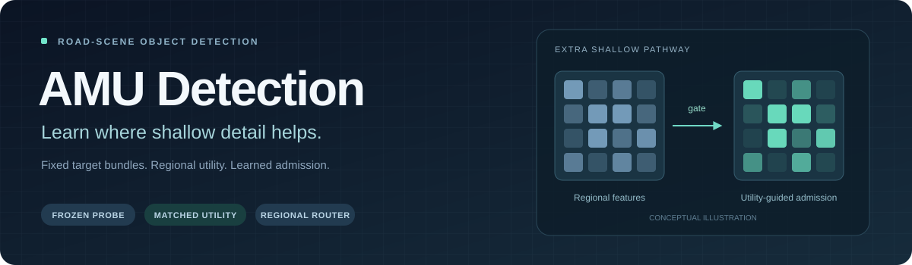
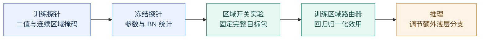

<p align="center"></p>

<p align="center"><strong>固定目标分配的浅层效用监督 · 道路场景目标检测</strong></p>

<p align="center">
  <a href="https://github.com/Nopon-Knowledge/AMU-Detection/actions/workflows/ci.yml"></a>
  <a href="pyproject.toml"></a>
  <a href="LICENSE"></a>
</p>

<p align="center"><a href="README.md">English</a> · <b>简体中文</b><br>
  <a href="#方法直觉">方法直觉</a> · <a href="#安装">快速开始</a> · <a href="#训练流程">训练流程</a> · <a href="docs/IMPLEMENTATION.md">实现说明</a>
</p>

浅层特征同时保留了目标边缘和背景纹理。**AMU Detection 通过固定目标的区域开关实验，学习哪些位置值得引入额外的浅层信息。**

实现依据论文 **Learning When Shallow Detail Helps through Assignment-Matched Utility Supervision for Road-Scene Object Detection** 的第 3–4 节和公式 (1)–(6)。

> [!NOTE]
> 本仓库是根据论文重新编写的实现，已通过功能和端到端流程测试。原始实验代码、数据划分清单和已训练权重未提供，因此尚未复现论文精度。重建模型约 2.60M 参数，与论文的 2.69M 有差异；具体选择见 [实现对应与边界](docs/IMPLEMENTATION.md)。

## 方法直觉

关闭一个浅层区域后，检测器的预测和目标分配都可能改变。直接相减两次检测损失，会把两种变化混在一起。本方法在每套完整目标下固定前景、GT 对应、软标签、回归框、权重和逐图分母，再对 on/off 两套参考的损失差取平均。



预测效用为正时保留区域，为负时按 `g = exp(min(0, z_hat))` 衰减。常规 backbone 连接保持存在；该分数描述条件效用，不等同于置信度，也不保证减少卷积计算量。

## 已实现

- YOLO11n 的额外浅层分支、P3 三输入融合、区域描述投影和 `48 → 24 → 1` 路由器。
- 探针的全开、全关、区域二值和连续衰减训练；导出最后一轮 FP32 EMA。
- 冻结探针、固定图像预处理、缓存前半网络；每图两次抽样，每次四个区域。
- 完整目标包的固定参考损失：前景、GT 对应、软类别目标、框、权重、逐图归一化分母。
- 对称效用 M9、重分配效用 M8、打乱标签 M10、检测损失路由器 M7；单侧参考敏感性入口。
- 训练、验证、图片/视频预测、网络延迟测量、关键不变量测试。

## 安装

推荐 Python 3.10 或 3.11。依赖锁定为 PyTorch 2.2.2、torchvision 0.17.2、Ultralytics 8.3.40，避免内部检测头和损失接口随版本变化。

```bash
git clone https://github.com/Nopon-Knowledge/AMU-Detection.git
cd AMU-Detection
python3 -m venv .venv
source .venv/bin/activate
python -m pip install -e '.[test]'
python -m pytest -q
python -m amu.cli --help
```

测试包含一个使用合成图片的小规模完整流程，无需自行准备数据集或预训练权重即可检查代码。

单 GPU 训练可用 `--device 0`；标签生成和路由器训练使用 `--device cuda:0`。默认 `cpu` 可用于流程测试。当前实现不提供多 GPU/DDP 训练。GPU 驱动及 CUDA 轮子需与 PyTorch 安装环境匹配。

## 数据准备

修改 `configs/kitti.yaml` 或 `configs/bdd100k.yaml` 中的 `path`。数据使用 YOLO 检测格式，每行 `class x_center y_center width height`，坐标归一化至原图。结构例如：

```text
KITTI_YOLO/
  images/train/000001.png
  images/val/000002.png
  labels/train/000001.txt
  labels/val/000002.txt
  train.txt
  val.txt
```

清单建议使用绝对图片路径；也支持相对于清单的 `./images/...` 路径。无目标图片应有空标签文件。标签生成遇到缺失文件会报错，防止把遗漏标注当作背景。类别顺序必须与 YAML 一致。

论文使用 KITTI 5,985/1,496、BDD100K 70,000/10,000 的训练/验证划分；原始图片 ID 清单未提供，不能仅凭数量重建同一划分。开发阶段请另建 `fit_dev.yaml`，配置选择只用训练池内部 fit/dev。锁定设置后再用正式 train/val。标签入口只读取 YAML 的 `train`，并拒绝与 `val` 重叠的图片路径。

## 训练流程

以下以 KITTI、seed 17 为例。

所有 `--output` 必须是新的目录，防止旧结果被覆盖。

```bash
# 1. 随机初始化，训练支持区域干预的探针；默认 300 epochs
amu train-probe --data configs/kitti.yaml --device 0 --seed 17 \
  --output runs/kitti/s17/probe

# 2. 冻结最后一轮 EMA；默认 640、2 draws × 4 regions
amu labels --data configs/kitti.yaml --device cuda:0 --seed 17 \
  --checkpoint runs/kitti/s17/probe/probe_final.pt \
  --output runs/kitti/s17/labels

# 3. 仅训练路由器及描述投影；默认 30 epochs
amu train-router --device cuda:0 --seed 17 \
  --checkpoint runs/kitti/s17/probe/probe_final.pt \
  --labels runs/kitti/s17/labels --target symmetric \
  --output runs/kitti/s17/m9

# 4. 固定最后一轮路由器，验证；metrics.json 中 AP 是 0–1 数值
amu evaluate --data configs/kitti.yaml --device 0 \
  --checkpoint runs/kitti/s17/m9/router_final.pt \
  --output runs/kitti/s17/eval_m9

# 5. 实际图片或视频预测；默认可视化置信阈值 .25
amu predict --source /absolute/path/to/images --device 0 \
  --checkpoint runs/kitti/s17/m9/router_final.pt \
  --output runs/kitti/s17/predictions
```

再分别使用种子 `43`、`89` 重跑探针和后续阶段，不要跨种子复用探针。BDD100K 替换数据配置和输出目录即可。标签清单包含探针 SHA256、数据配置 SHA256、图片路径、抽样设置及分片校验和；路由器会检查标签来自同一个探针。

快速检查真实数据接口可将探针设置为 `--epochs 1 --imgsz 128 --batch 2 --workers 0`，标签设置 `--imgsz 128 --limit 2 --regions 2 --draws 1`，路由器设置 `--epochs 1`。这只检查代码能否运行，不能用于论文结果。

## 配对监督对照

M8/M9/M10 使用同一个种子的探针和同一目录中的标签；初始化、维度和回归训练设置相同。

```bash
amu train-router --device cuda:0 --seed 17 \
  --checkpoint runs/kitti/s17/probe/probe_final.pt \
  --labels runs/kitti/s17/labels --target reassigned --output runs/kitti/s17/m8

amu train-router --device cuda:0 --seed 17 \
  --checkpoint runs/kitti/s17/probe/probe_final.pt \
  --labels runs/kitti/s17/labels --target symmetric --shuffled --output runs/kitti/s17/m10

amu train-detection-router --device cuda:0 --seed 17 --data configs/kitti.yaml \
  --checkpoint runs/kitti/s17/probe/probe_final.pt --output runs/kitti/s17/m7
```

`--target on` 和 `--target off` 对应两种单侧固定参考。`evaluate --mode on/off` 用于全部接通/切断额外浅层分支。M7 逐图计算、按图片批次累积梯度；无需标签缓存。若比较 matched-flow 总训练成本，应将共用标签生成的耗时计入各分支，不能只统计回归时间。

## 延迟

```bash
amu benchmark --checkpoint runs/kitti/s17/m9/router_final.pt --device cuda:0
```

默认 FP32、640、batch 1、200 次预热、5 轮各 1,000 次，CUDA 使用同步事件。结果仅为**未做卷积融合的网络耗时**，不包含解码、预处理、传输、NMS，不可直接当作论文 RTX 3090 的端到端延迟。此入口不计算 FLOPs。

## 文件导航

| 文件 | 用途 |
|---|---|
| `amu/model.py` | YOLO11n 接入、前半网络缓存、权重读写 |
| `amu/routing.py` | 区域池化、干预分布、投影、MLP、门控映射 |
| `amu/utility.py` | 目标包、固定目标损失、四种效用标签 |
| `amu/training.py` | 探针、标签缓存、回归路由器和 M7 训练 |
| `amu/data.py` | 确定性 letterbox、YOLO 标注、划分读取 |
| `amu/evaluation.py` | 验证、预测、网络延迟 |
| `tests/` | 数学不变量、梯度隔离和流程测试 |

依赖接口依据：[YOLO11 官方说明](https://docs.ultralytics.com/models/yolo11/)、[锁定版本模型定义](https://github.com/ultralytics/ultralytics/blob/v8.3.40/ultralytics/cfg/models/11/yolo11.yaml)、[锁定版本检测损失](https://github.com/ultralytics/ultralytics/blob/v8.3.40/ultralytics/utils/loss.py)。第三方 Ultralytics 代码和依赖遵循其 AGPL-3.0 或其商业许可，本目录没有重新授权这些依赖。

## 开源与贡献

本项目采用 [AGPL-3.0](LICENSE) 许可证，第三方声明见 [NOTICE](NOTICE)。欢迎提交可复现的问题和改进，具体步骤见 [贡献指南](CONTRIBUTING.md)。本地验证记录见 [VALIDATION.md](docs/VALIDATION.md)。
